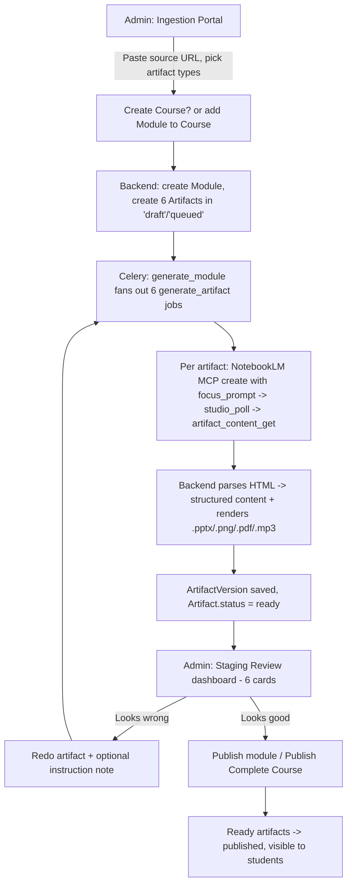
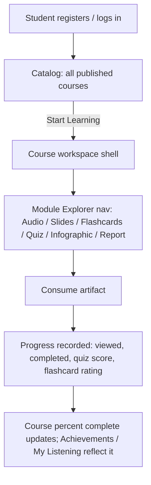
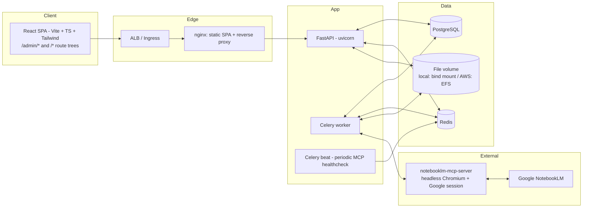
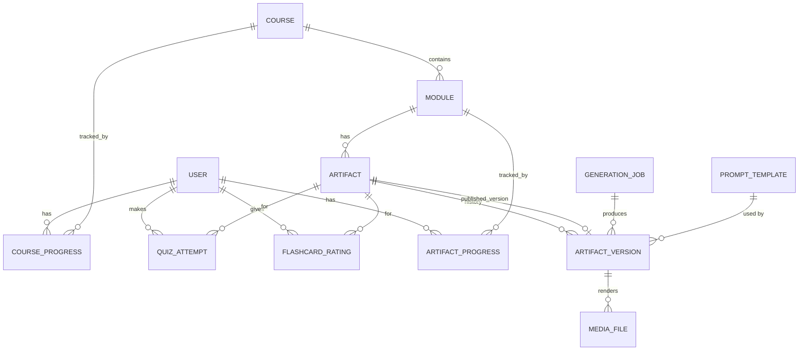

# Shikshak Dp — AI Course Content Suite
## Complete Project Frame

**Status:** Draft for review
**Date:** 2026-09-02
**Owner:** raviteja.machavarapu333@gmail.com (Admin / Product owner)

---

## 0. How to read this document

This is the master frame for the application. It is the source of truth that the
Spec-Kit documents in this folder elaborate:

| File | Purpose |
|------|---------|
| `PROJECT_FRAME.md` (this file) | The whole picture: vision, roles, concepts, workflows, architecture, data model, APIs, NFRs, risks. |
| `constitution.md` | Non-negotiable engineering principles the build must obey. |
| `spec.md` | The functional specification: user stories, screen-by-screen behaviour, acceptance criteria. |
| `plan.md` | The technical implementation plan: concrete stack, service topology, module layout, phasing. |
| `tasks.md` | The ordered, dependency-aware task list with acceptance criteria per task. |
| `task-tracker.md` | Live status board. Updated as each task is completed. |
| `implementation.md` | Execution runbook: environment setup, coding standards, Definition of Done, task workflow. |

Every decision below that came from a clarification with the product owner is
recorded in **§16 Decisions Log**. Anything still unresolved is in
**§17 Open Items** — those must be closed before the tasks that depend on them.

---

## 1. Vision

Shikshak Dp turns a single **source link** (YouTube video, article, PDF, Google
Drive doc) into a complete set of **six learning artifacts**:

1. **Slide Deck**
2. **Flashcards**
3. **Interactive Quiz**
4. **Executive Report**
5. **Concept Infographic**
6. **Audio Overview**

Generation is performed in the backend by driving **Google NotebookLM** through
the community **NotebookLM MCP server**
(`https://github.com/moodRobotics/notebooklm-mcp-server`). Each artifact type is
steered by an **admin-authored system prompt** stored in the backend.

Generated content lands in a **private admin staging area**. The admin reviews
every artifact, clicks **Redo** (optionally with a written instruction) on
anything they don't like to regenerate *only that artifact*, and clicks
**Publish** when satisfied. Only published content is visible to students.

One application hosts **two experiences** with **separate login pages**:

- **Admin experience** — ingestion, staging review, course editor, prompt
  settings. Never linked from or reachable by student accounts.
- **Student experience** — course catalog and a per-course workspace to consume
  the six artifacts, with full progress tracking.

---

## 2. Roles & access model

| Role | Can do | Cannot do |
|------|--------|-----------|
| **Admin** | Log in at the admin login page. Ingest sources, run/redo generation, review staged content, edit generation prompts, publish, manage courses/modules, view all data. | — |
| **Student** | Self-register and log in at the student login page. Browse published courses, consume artifacts, track progress, take quizzes, rate flashcards. | Reach any `/admin` route or `/api/admin/*` endpoint. See any unpublished artifact or staging data. |

**Boundary enforcement (defence in depth):**

1. Separate login pages issue **separate session cookies** with distinct names
   and scopes (`sdp_admin` vs `sdp_student`), `HttpOnly`, `Secure`,
   `SameSite=Lax`.
2. Every `/api/admin/*` route depends on a server-side guard that requires a
   valid admin session **and** `role == admin`. A student cookie on an admin
   route returns `403`, never a redirect that leaks structure.
3. The student API only ever returns artifacts whose `status == published`.
   Staging content is filtered at the query layer, not the view layer.
4. The admin SPA bundle is served under `/admin` and is **not referenced** by
   any student page, sitemap, or navigation.
5. Admin accounts are **not self-service**. They are created by the
   `seed-admin` CLI / admin-only user management. Student registration cannot
   escalate to admin.

---

## 3. Domain concepts (glossary)

| Term | Definition |
|------|-----------|
| **Course** | The top-level unit students enrol in conceptually (all published courses are visible to all students — see Decisions Log D9). Has a title, description, category, cover image, and an ordered list of Modules. |
| **Module** | One unit of learning generated from **one source link**. Belongs to a Course, has an order index. Owns exactly **six Artifacts** (one per type). Mirrors the "Video Source" rows in the Course Content Architecture design. |
| **Artifact** | One of the six content pieces for a Module. Has a `type`, a `status`, a pointer to its current `published_version`, and a history of `ArtifactVersion`s. |
| **ArtifactVersion** | An immutable snapshot produced by one generation or redo run. Holds the structured content (JSON/HTML), rendered files (`.pptx`, `.png`, `.pdf`, `.mp3`), the `focus_prompt` used, the optional redo note, and provenance (job id, NotebookLM notebook/artifact ids, timestamps). |
| **Generation Job** | An async (Celery) unit of work: "generate module" fans out to six "generate artifact" jobs; "redo artifact" is a single job. Tracks queue/running/succeeded/failed state and error detail. |
| **Prompt Template** | The admin-editable system prompt for one artifact type, passed to NotebookLM as `focus_prompt`. Versioned. Seeded from placeholder files; final text supplied by the product owner later. |
| **Media File** | A file on the storage volume (rendered artifact output). Tracked in DB by logical key, MIME type, size, checksum, owning ArtifactVersion. |
| **Staging** | The private admin-only view of a Module's artifacts before publish. |
| **Publish** | The act of promoting a Module's `ready` artifacts to `published`, making them student-visible. Can be done per-Module or, via "Publish Complete Course", across all Modules. |
| **Progress** | Per-student, per-artifact/module/course records: viewed, completed, quiz score, flashcard difficulty ratings, course percent complete. |

### Status models

**Artifact.status**

```
draft ──▶ queued ──▶ processing ──▶ ready ──▶ published
                          │            │
                          ▼            ▼
                        error       (redo) ──▶ queued …
```

- `draft` — module created, this artifact not yet requested.
- `queued` — job accepted, waiting for a worker.
- `processing` — worker is calling NotebookLM / rendering.
- `ready` — a version exists and is awaiting admin review.
- `error` — last run failed; carries an error message; retryable via Redo.
- `published` — current published version is live for students. A Redo on a
  published artifact creates a new version and moves it back to `ready`; the
  **previously published version stays live** until the new one is published.

**Module.status** (derived): `draft` → `processing` → `pending_review`
(≥1 ready, none processing) → `partially_published` → `published` → `error`.

**Course.status** (derived): `draft` → `pending_review` → `partially_published`
→ `published`.

---

## 4. End-to-end workflows

### 4.1 Admin: ingest → review → publish



### 4.2 Student: discover → learn → progress



---

## 5. Feature breakdown (screen by screen)

Screens map 1:1 to the reference designs in
`ai_course_content_suite/`. Design system: `academic_modernist/DESIGN.md`
(Public Sans + Inter, Material Symbols, Tailwind tokens already present in each
`code.html`). Brand: **Shikshak Dp**.

### 5.1 Admin

#### A1 — Ingestion Portal (`admin_ingestion_portal/`)
- Header: brand, **NotebookLM MCP: Connected / Disconnected** live badge, settings, notifications, avatar.
- Left nav: **New Artifact** (primary button → focuses the form), **Ingestion**, **Review**, **Editor**, **Settings**.
- **Create New AI Course Module** card:
  - **Source URL** input with link icon; validates URL shape and supported hosts (YouTube, generic web, Google Drive, PDF link).
  - Target selector: *new Course* (title, description, category, cover) **or** *add module to existing Course* (searchable select) + module title.
  - **Artifacts to Generate**: six checkboxes (Slide Deck, Quiz, Flashcards, Audio Overview, Infographics, Report), all checked by default.
  - **Generate Course Material** button → creates the Module + Artifacts, enqueues `generate_module`, redirects to Staging.
- **Recent Pipeline** table: Source Title/URL, Date, Artifacts (six status dots), Global Status chip (Processing / Pending Review / Published / Error), Action → **Open Staging**. **View All** → full list with pagination and filters.

#### A2 — Staging Review Dashboard (`admin_staging_review_dashboard/`)
- **Back to Ingestion** link; Module title; **Status: Pending Review** chip; **Publish Complete Course** button (green, enabled when ≥1 artifact across the course is `ready`; confirmation modal lists exactly what will go live and what is skipped).
- Six artifact cards, each:
  - Live preview thumbnail appropriate to the type (slide frame with "3 / 8", quiz Q with highlighted answer, flashcard stack, audio waveform + duration, infographic flow shapes, report skeleton).
  - **READY** chip when a version exists; **Generating…** spinner with disabled buttons while `queued`/`processing`; **Error** state with message + Retry.
  - **Redo _[Type]_** button → modal with an optional multi-line **instruction** field ("make it shorter", "fix the wrong answer in Q3"). Submitting enqueues a single `redo_artifact` job. The note is appended to that run's `focus_prompt` and stored on the new version.
  - **Inspect** button → read-only viewer for that artifact type (v1 has **no inline editing** — Decisions Log D6). Viewer renders the same content the student will see.
  - Audio card additionally offers **⬇ .mp3**; Slides/Infographic/Report offer their respective downloads (`.pptx`, `.png`/`.svg`, `.pdf`).
- Per-module **Publish** action (in addition to Publish Complete Course): promotes this module's `ready` artifacts to `published`.

#### A3 — Course Content Architecture / Editor (`admin_course_content_architecture/`)
- Breadcrumb **Course Editor › Structure**; Course title; **Add New Video Source** button (same form as A1, pre-scoped to this course).
- Ordered list of Modules. Each row: index + title, source URL + duration, module status chip (Processed / Processing / Error), kebab menu (Open staging, Rename, Reorder up/down, Re-run all, Delete).
- Under each module: six artifact tiles (Slides, Flashcards, Quiz, Audio, Infographic, Report) with per-artifact status (READY / PROCESSING / ERROR / PENDING) and click-through to that artifact's Inspect view.

#### A4 — Settings (referenced by nav in every admin design)
- **Generation Prompts**: one editor per artifact type (Slide Deck, Flashcards, Quiz, Report, Infographic, Audio Overview). Shows current text, version number, last-edited-by/at. Save creates a new PromptTemplate version. A **Restore default** action.
- **NotebookLM connection**: status, account email in use, "Re-authenticate" instructions, `refresh_auth` trigger, last successful call.
- **Audio options**: default voice/style parameters exposed by `audio_overview_create` (kept minimal in v1).
- **Users** (admin-only): list admins, create admin (seed flow), deactivate.

#### A5 — Admin shell
- Persistent left nav + header (MCP badge, notifications, avatar/logout). Notifications v1 = job completion/failure list (polled).

### 5.2 Student

#### S1 — Course Catalog (`student_course_catalog_audio_portal/`)
- Header: brand, search, nav (**Catalog**, **My Listening**, **Achievements**), profile/logout.
- **Course Catalogs** heading + subtitle.
- Category filter chips (All + distinct course categories).
- Course cards: cover image, total audio duration badge, title, description, artifact counts (e.g. "12 Audio Tracks", "12 Quizzes", …), **X% Complete** + progress bar, **Start Learning** button (violet). Search filters by title/description; chips filter by category.

#### S2 — Course workspace shell (all `student_workspace_*` designs)
- Top bar: **Individual Course** / **Course Overview** link / **X% Complete** / **Back to Dashboard**.
- Left **Module Explorer**: "Current: Unit N", then **Audio, Slides, Flashcards, Quiz, Infographic, Report**. Selecting a module + artifact type loads that view. Only published artifacts are shown; unpublished slots are hidden or marked "Coming soon" (Decisions Log D7 — default: hidden).

#### S3 — Slides (`student_workspace_slide_deck_updated/`)
- Slide image viewer, **‹ ›** navigation, "Slide N of M", fullscreen toggle.
- **Instructor Notes** panel below (from the slide's speaker notes) with tags.
- Download **.pptx**.

#### S4 — Flashcards (`student_workspace_flashcards_updated/`)
- Flip card (click or Space), category tag on the front, **‹ Prev / Next ›**, "N of M".
- **Rate difficulty: Hard / Good / Easy** — persisted per student per card; drives review ordering.

#### S5 — Quiz (`student_workspace_interactive_quiz_updated/`)
- "Question N of M", segmented progress, question text, four options A–D (single select), **Previous / Next Question**, **Submit** on the last question.
- Results view: score, per-question correct/incorrect with the stored explanation. Attempt persisted; retake allowed (all attempts stored, best + latest surfaced).

#### S6 — Infographic (`student_workspace_high_fidelity_infographic/`)
- Zoomable/pannable diagram (SVG), zoom in/out, fullscreen, caption text.
- Download **.png**.

#### S7 — Report (`student_workspace_executive_report_updated/`)
- **Reading Focus Mode**, estimated read time, title, hero image, **Key Takeaways** callout, numbered sections (rendered from sanitized HTML), **Previous / Complete Module**, download **.pdf** (FAB).
- **Complete Module** marks the module complete for progress.

#### S8 — Audio (`student_workspace_audio_experience/`)
- Large play control, "Listen to Lesson" + lesson title, player: scrub bar with elapsed/total, **−10s / play / +10s**, **speed** (1x/1.25x/1.5x/2x), **volume**, **Transcript** toggle (transcript panel — see Open Items O2 for source).
- Lesson info card + **Next Lesson**. Playback position persisted per student.

#### S9 — My Listening / Achievements
- **My Listening**: courses/modules with audio progress and resume points.
- **Achievements**: course completion, quiz milestones, flashcard streaks. v1 scope kept to completion + quiz-score badges (Decisions Log D8).

---

## 6. Content pipeline architecture

### 6.1 Providers

The backend talks to content generation through a single interface,
`ContentProvider`, so the NotebookLM MCP can be swapped or mocked.

- **`NotebookLmMcpProvider`** — production. Speaks MCP (JSON-RPC over stdio/HTTP)
  to the `notebooklm-mcp-server` running as its own service.
- **`FixtureProvider`** — local dev/CI. Returns canned artifacts from
  `backend/tests/fixtures/` so the full pipeline and both UIs can be built and
  tested without a live Google session.

### 6.2 NotebookLM MCP — verified capability

Tools the pipeline uses (from the server's `docs/TOOLS.md`):

| Step | Tool | Notes |
|------|------|-------|
| Create notebook per Module | `notebook_create` | Returns notebook id. |
| Add the source | `notebook_add_url` | YouTube/web/Drive/PDF supported. |
| Generate each artifact | `slide_deck_create`, `flashcards_create`, `quiz_create`, `report_create`, `infographic_create`, `audio_overview_create` | **Each accepts a `focus_prompt` (string)** — this is where the admin's Prompt Template (+ optional redo note) is passed. `focus_prompt` is free-text *steering*, not a full instruction block. |
| Wait for completion | `studio_poll` | Studio generation "can take minutes", especially audio and long sources. |
| Fetch content | `artifact_content_get` | Returns `{ artifact_id, html, mind_map_tree }`. Text artifacts come back as **HTML**. |
| Re-auth | `refresh_auth` | No params; reloads persisted cookies. Requires prior `npx notebooklm-mcp-server auth`. |

### 6.3 Per-artifact processing

| Artifact | From MCP | Backend processing | Student render | Downloads |
|----------|----------|--------------------|----------------|-----------|
| **Slide Deck** | `slide_deck_create` → `artifact_content_get` HTML | Parse HTML into an ordered slide model (`title`, `bullets[]`, `notes`). Build `.pptx` with **python-pptx**. Convert `.pptx` → per-slide **PNG** + a combined **PDF** via **LibreOffice headless** (`soffice --headless --convert-to`). | PNG page viewer + Instructor Notes | `.pptx` |
| **Flashcards** | `flashcards_create` → HTML | Parse into `[{front, back, category, hint?}]`. Schema-validate. | Flip-card deck | (optional CSV — out of scope v1) |
| **Quiz** | `quiz_create` → HTML | Parse into `[{question, options[4], correct_index, explanation}]`. Schema-validate; reject if not exactly 4 options or no marked answer → `error`. | Interactive quiz + scoring | — |
| **Report** | `report_create` → HTML | Sanitize HTML (allowlist). Extract "Key Takeaways" + sections + est. read time. Render **PDF** via **WeasyPrint**. | Reading mode | `.pdf` |
| **Infographic** | `infographic_create` → HTML/content | Primary: derive a diagram spec (**Mermaid** or **Graphviz**) from the returned structure and render **SVG + PNG** server-side (deterministic). See Open Item O1 re: using NotebookLM's own image if retrievable. | Zoom/pan SVG viewer | `.png` |
| **Audio Overview** | `audio_overview_create` → `studio_poll` | Retrieve the generated **.mp3** and store it. **Retrieval mechanism is not documented by the MCP** — see Open Item O2. Transcript source also O2. | Audio player + transcript | `.mp3` |

Every parse step is defensive: malformed NotebookLM output puts the artifact in
`error` with a human-readable reason rather than publishing garbage. This is the
first line; admin review is the second.

### 6.4 Prompt Templates

- Six templates, keyed by artifact type, stored in `prompt_templates` (DB),
  each with `version`, `body`, `updated_by`, `updated_at`.
- Seeded on first run from `backend/app/prompts/<type>.md` **placeholder** files.
  The product owner supplies final text later; no behaviour depends on the
  placeholder wording.
- At generation time: `focus_prompt = active_template.body` (+ `"\n\nAdditional
  instruction for this regeneration: " + redo_note` when present).
- The exact template version used is copied onto each `ArtifactVersion` for
  provenance.

### 6.5 Jobs

- **Broker/result backend:** Redis. **Worker:** Celery.
- `generate_module(module_id, types[])` → creates a job group, enqueues one
  `generate_artifact(artifact_id)` per type.
- `generate_artifact` / `redo_artifact`: idempotent per `(artifact_id, attempt)`;
  updates `Artifact.status`; on success writes an `ArtifactVersion` and sets
  `ready`; on exception sets `error` with detail; retries transient MCP errors
  with backoff (bounded).
- Job state is queryable at `/api/admin/jobs/...`; the admin UI polls (2–3s)
  while any artifact in view is `queued`/`processing`.
- Concurrency is capped (config) to respect NotebookLM's undocumented limits and
  the fact that it is a shared single Google session.

---

## 7. System architecture



### 7.1 Stack (see `plan.md` for versions)

| Layer | Choice |
|-------|--------|
| Frontend | React + Vite + TypeScript, Tailwind CSS (tokens ported from the reference designs), React Router, TanStack Query, Zustand for local UI state. |
| Backend | Python, **FastAPI**, Pydantic v2, SQLAlchemy 2.x, Alembic. |
| Async | **Celery + Redis**. |
| DB | **PostgreSQL**. |
| Files | Local filesystem volume (dev bind mount; AWS **EFS** in prod). DB stores logical keys + metadata. |
| Rendering | python-pptx, LibreOffice headless, WeasyPrint, Mermaid CLI / Graphviz. |
| Content gen | NotebookLM MCP server (separate container). |
| Auth | Server-issued HttpOnly session cookies, Argon2 password hashing, per-page session scopes. |
| Deploy | Docker images; **AWS** target (ECS Fargate + RDS + ElastiCache + EFS + ALB + ECR + Secrets Manager), Terraform skeleton; GCP equivalents documented. |

### 7.2 Services / containers

`web` (nginx+SPA), `api` (FastAPI), `worker` (Celery), `beat` (Celery beat),
`mcp` (notebooklm-mcp-server), `postgres`, `redis`. Dev adds `mailhog`.

---

## 8. Data model



### 8.1 Entities (key fields)

**user**
`id, email (unique), password_hash, role ('admin'|'student'), display_name,
is_active, created_at, last_login_at`

**course**
`id, title, slug, description, category, cover_image_key, status (derived/cached),
created_by, created_at, updated_at, published_at`

**module**
`id, course_id, order_index, title, source_url, source_type
('youtube'|'web'|'drive'|'pdf'), source_duration_seconds (nullable),
notebooklm_notebook_id (nullable), status (derived/cached), created_at, updated_at`

**artifact**
`id, module_id, type ('slide_deck'|'flashcards'|'quiz'|'report'|'infographic'
|'audio_overview'), status, current_version_id (nullable),
published_version_id (nullable), last_error (nullable), updated_at`
— unique `(module_id, type)`.

**artifact_version**
`id, artifact_id, revision (int, increasing), generation_job_id,
prompt_template_id, prompt_template_version, focus_prompt_used, redo_note
(nullable), content_json (jsonb, nullable), content_html (text, nullable),
notebooklm_artifact_id (nullable), created_at, created_by`

**media_file**
`id, artifact_version_id, kind ('pptx'|'slide_png'|'deck_pdf'|'report_pdf'
|'infographic_png'|'infographic_svg'|'audio_mp3'|'cover'|'hero'),
storage_key, mime_type, size_bytes, checksum_sha256, page_index (nullable),
created_at`

**generation_job**
`id, kind ('generate_module'|'generate_artifact'|'redo_artifact'),
module_id (nullable), artifact_id (nullable), state ('queued'|'running'
|'succeeded'|'failed'|'cancelled'), attempts, error_detail (nullable),
requested_by, created_at, started_at, finished_at`

**prompt_template**
`id, artifact_type, version, body, is_active, updated_by, updated_at`
— one `is_active` row per `artifact_type`.

**course_progress**
`id, user_id, course_id, percent_complete, last_module_id, updated_at`
— unique `(user_id, course_id)`.

**artifact_progress**
`id, user_id, artifact_id, module_id, viewed_at, completed_at (nullable),
audio_position_seconds (nullable), slide_last_index (nullable), updated_at`
— unique `(user_id, artifact_id)`.

**quiz_attempt**
`id, user_id, artifact_id, answers_json, score_percent, correct_count,
total_count, started_at, submitted_at`

**flashcard_rating**
`id, user_id, artifact_id, card_index, rating ('hard'|'good'|'easy'),
updated_at` — unique `(user_id, artifact_id, card_index)`.

**audit_log** (admin actions)
`id, actor_user_id, action, entity_type, entity_id, detail_json, created_at`

### 8.2 Content JSON shapes (`artifact_version.content_json`)

```jsonc
// slide_deck
{ "slides": [ { "title": "…", "bullets": ["…"], "notes": "…", "tags": ["…"] } ] }

// flashcards
{ "cards": [ { "front": "…", "back": "…", "category": "Definition", "hint": null } ] }

// quiz
{ "questions": [ { "question": "…", "options": ["A","B","C","D"],
                  "correct_index": 2, "explanation": "…" } ] }

// report
{ "title": "…", "read_minutes": 12, "hero_image_key": "…",
  "key_takeaways": ["…"], "sections": [ { "heading": "1. …", "html": "…" } ] }

// infographic
{ "caption": "…", "diagram_kind": "mermaid|graphviz", "diagram_source": "…" }

// audio_overview
{ "duration_seconds": 872, "voice": "…", "transcript": [ { "t": 0.0, "text": "…" } ] }
```

---

## 9. API surface (representative — full contract in `spec.md` / OpenAPI)

### Auth
- `POST /api/student/auth/register`
- `POST /api/student/auth/login` · `POST /api/student/auth/logout` · `GET /api/student/auth/me`
- `POST /api/admin/auth/login` · `POST /api/admin/auth/logout` · `GET /api/admin/auth/me`

### Admin — ingestion & courses
- `POST /api/admin/courses` · `GET /api/admin/courses` · `GET /api/admin/courses/{id}` · `PATCH /api/admin/courses/{id}`
- `POST /api/admin/courses/{id}/modules` (source URL + types) → creates module + artifacts + job
- `PATCH /api/admin/modules/{id}` (rename, reorder) · `DELETE /api/admin/modules/{id}`
- `POST /api/admin/modules/{id}/regenerate` (re-run all)
- `GET /api/admin/pipeline` (Recent Pipeline table, paginated, filterable)

### Admin — staging, redo, publish
- `GET /api/admin/modules/{id}/staging` (6 artifacts + latest versions + job state)
- `GET /api/admin/artifacts/{id}` (inspect: content + media urls)
- `POST /api/admin/artifacts/{id}/redo` (`{ note?: string }`)
- `POST /api/admin/modules/{id}/publish`
- `POST /api/admin/courses/{id}/publish` (Publish Complete Course)
- `GET /api/admin/jobs/{id}` · `GET /api/admin/modules/{id}/jobs`

### Admin — settings
- `GET /api/admin/prompts` · `GET /api/admin/prompts/{type}` · `PUT /api/admin/prompts/{type}` · `POST /api/admin/prompts/{type}/restore-default`
- `GET /api/admin/mcp/status` · `POST /api/admin/mcp/refresh-auth`
- `GET /api/admin/users` · `POST /api/admin/users` · `PATCH /api/admin/users/{id}`

### Student
- `GET /api/student/courses` (published only; progress merged in) · `GET /api/student/courses/{slug}`
- `GET /api/student/modules/{id}` (published artifacts only)
- `GET /api/student/artifacts/{id}` (published version content + media urls)
- `POST /api/student/artifacts/{id}/progress` (viewed/completed/position/index)
- `POST /api/student/artifacts/{id}/quiz-attempts` · `GET /api/student/artifacts/{id}/quiz-attempts`
- `PUT /api/student/artifacts/{id}/flashcard-ratings/{cardIndex}`
- `GET /api/student/me/progress` · `GET /api/student/me/listening` · `GET /api/student/me/achievements`

### Media
- `GET /api/media/{storage_key}` — access-checked: admin any; student only if the
  owning artifact version is the published version of a published artifact.

---

## 10. Non-functional requirements

| Area | Requirement |
|------|-------------|
| **Performance** | Catalog and workspace pages interactive < 2s on a warm cache. Media served with caching headers. Generation is async; UI never blocks on it. |
| **Scalability** | Stateless `api`; horizontally scalable. Worker concurrency configurable; NotebookLM calls serialized/capped. |
| **Reliability** | Jobs survive worker restart (Redis-backed). Failed artifacts are individually retryable without touching siblings. Previously published content is never taken down by a failed/redone regeneration. |
| **Security** | See §11. |
| **Accessibility** | WCAG 2.1 AA target: keyboard nav for all controls, focus states, alt text on generated images, transcript for audio, semantic headings, colour contrast per the design tokens. |
| **Browser support** | Latest 2 versions of Chrome, Edge, Firefox, Safari. |
| **Observability** | Structured JSON logs with request/job ids; error tracking hook (Sentry-compatible); MCP connectivity metric; job success/failure counts. |
| **i18n** | Copy externalised; English only in v1. |
| **Data retention** | ArtifactVersions retained (history). A config-bounded number of superseded rendered media files may be garbage-collected; the published and current versions are always kept. |
| **Testing** | Backend unit + API integration; frontend component + Playwright e2e for the core flows; an explicit "every button does something" checklist (see `spec.md` §Button inventory). |

---

## 11. Security & privacy

- Argon2id password hashing; login rate-limited and lockout-backed-off per IP + per account.
- Session cookies: `HttpOnly`, `Secure`, `SameSite=Lax`, separate names/scopes for admin vs student, short idle timeout for admin.
- CSRF: same-site cookies + a CSRF token on state-changing requests.
- All admin endpoints server-side role-guarded; automated test asserts every
  `/api/admin/*` route rejects a student session and anonymous access.
- Output sanitisation: NotebookLM-returned HTML is sanitised against a strict
  allowlist before storage and render (no scripts, no remote objects).
- Uploaded/generated media served through an access-checked endpoint, not a
  public directory listing.
- Secrets (DB URL, Redis URL, session secret, MCP endpoint) via environment /
  AWS Secrets Manager; never in the repo.
- The NotebookLM MCP uses a **dedicated Google account** (not a personal
  primary account). Its `auth.json` lives on a restricted volume. Source links
  submitted by the admin are sent to Google NotebookLM — this is inherent to the
  design and documented for the operator.
- Audit log for all admin mutations (ingest, redo, publish, prompt edits, user
  changes).

---

## 12. External dependencies & risks

| Dependency | Risk | Mitigation |
|-----------|------|-----------|
| **NotebookLM MCP server** — unofficial, reverse-engineered internal Google APIs. | Google changes internals; tools break without notice. | Pin the MCP version; `ContentProvider` abstraction; `FixtureProvider` keeps dev/CI unblocked; monitor MCP healthcheck; document upgrade runbook. |
| **Google auth via exported cookies.** | **DBSC (Device Bound Session Credentials)** — default on Workspace and most personal accounts — makes exported cookies unusable. | **Operator must use a Google account without DBSC enforcement.** Documented as a hard prerequisite in `implementation.md`. Session also expires after weeks → `refresh_auth` runbook. |
| **Studio generation latency** — minutes per artifact, longer for audio/long sources. | Slow admin feedback loop. | Fully async; per-artifact status; generous job timeouts; concurrency cap; progress UI. |
| **HTML parsing of Studio output.** | NotebookLM markup changes → parser breaks → artifacts land in `error`. | Defensive parsers with clear error messages; schema validation; parser unit tests against captured fixtures; admin review as backstop. |
| **Audio `.mp3` + infographic image retrieval not documented in the MCP.** | Can't reliably obtain the binary. | **Open Item O1/O2** — spike task before those pipeline tasks; fallbacks defined (infographic: render our own SVG/PNG from structure; audio: block on spike, escalate to owner). |
| **Single shared Google session.** | Concurrency / rate issues. | Serialize NotebookLM calls; backoff; cap module fan-out. |

---

## 13. Environments & deployment

| Env | Runs | Content provider | Notes |
|-----|------|------------------|-------|
| **Local dev** | `docker compose up` (all services) or bare processes. | `FixtureProvider` by default; `NotebookLmMcpProvider` opt-in via env once `mcp` is authed. | Bind-mount file volume; mailhog for email. |
| **CI** | Backend + frontend test suites, Playwright e2e. | `FixtureProvider` only. | No external network to Google. |
| **Staging / Prod (AWS)** | ECS Fargate services: `web`, `api`, `worker`, `beat`, `mcp`. RDS PostgreSQL. ElastiCache Redis. **EFS** mounted to `api` + `worker` for the file volume. ALB. ECR images. Secrets Manager. CloudWatch logs. | `NotebookLmMcpProvider`. | Terraform skeleton in `infra/`. GCP mapping (Cloud Run, Cloud SQL, Memorystore, Filestore) documented but not built in v1. |

The AWS target is a documented default chosen by the owner ("Cloud target
(AWS/GCP)"); swapping to GCP changes only `infra/` and the deploy runbook.

---

## 14. Out of scope for v1

- Inline editing of generated content by the admin (structure is in place; UI is
  "Inspect" read-only). Planned v2.
- Student enrolment / course assignment (all published courses visible to all
  students).
- Payments, certificates, discussion/comments, notifications by email/push.
- Multi-language content, multi-tenant / org separation.
- Anki/CSV export of flashcards, SCORM/LTI, mobile apps.
- Admin-configurable artifact types beyond the fixed six.
- Video Overview artifact (MCP supports it; not one of the six).

---

## 15. Acceptance (top-level)

The build is accepted when:

1. An admin can log in (admin login page only), submit a source URL, and get six
   artifacts generated into private staging.
2. A student session cannot reach any admin route/API or any unpublished
   content (automated test proves it).
3. The admin can Redo any single artifact — with an optional instruction note —
   and only that artifact regenerates; a new version is stored; siblings and any
   already-published version are untouched.
4. The admin can Publish per module and Publish Complete Course; only `ready`
   artifacts go live; partial states are shown honestly.
5. Students see published courses in the catalog and can consume all six
   artifact types with the exact interactions in the reference designs
   (slides nav + notes + .pptx, flashcards flip + rate, quiz answer + score +
   explanation, report read + .pdf + complete, infographic zoom + .png, audio
   play/scrub/speed/transcript + .mp3).
6. Progress is tracked and reflected in catalog %, My Listening, Achievements.
7. Both UIs match `academic_modernist/DESIGN.md` and the reference screens; the
   button inventory checklist in `spec.md` is 100% green.
8. `FixtureProvider` lets the whole thing run with no live Google session.
9. Docs updated: OpenAPI, admin guide, student guide, ops runbook (MCP re-auth,
   backups, restore).

---

## 16. Decisions Log (from owner clarifications)

| # | Decision | Rationale / source |
|---|----------|--------------------|
| D1 | **Stack: React SPA (Vite/TS) + FastAPI (Python) + PostgreSQL.** | Owner choice. Python pairs well with the MCP/rendering tooling. |
| D2 | **Content pipeline: MCP generates, backend renders.** NotebookLM `*_create` + `artifact_content_get`; our backend parses/normalises and produces files. | Owner choice ("MCP returns text, we render"). Reconciled with verified MCP capability (native Studio generators + `focus_prompt`). |
| D3 | **Auth: separate admin & student login pages**, separate session scopes, server-side role guard, no admin self-signup. | Owner choice. |
| D4 | **Content model: Course → Modules → 6 Artifacts.** One source link per Module. | Owner choice; matches the Course Content Architecture design. |
| D5 | **Slides & Infographics produced as real files** (`.pptx`, image). Report → `.pdf`. Audio → `.mp3`. Flashcards/Quiz remain interactive JSON. | Owner choice ("Export real .pptx / image files"). |
| D6 | **No inline editing in v1.** "Inspect & Edit" → **Inspect** (read-only). Data model still versioned for a future editor. | Owner choice ("Redo + Publish only for now"). |
| D7 | **Redo takes an optional instruction note**, appended to that run's `focus_prompt`; every run creates a new immutable `ArtifactVersion`. | Owner choice. |
| D8 | **Spec-Kit docs delivered as a flat `docs/` folder** (this folder). | Owner choice. |
| D9 | **Students: self-signup; all published courses auto-visible** (no enrolment step). "Start Learning" just opens the course. | Owner choice. |
| D10 | **Jobs: Celery + Redis.** | Owner choice. |
| D11 | **Deploy target: AWS** (Compose for dev; Terraform skeleton + runbook for AWS; GCP mapping documented only). | Owner choice ("Cloud target (AWS/GCP)"); AWS picked as the concrete default. |
| D12 | **File storage: local filesystem volume** (bind mount in dev, EFS on AWS); DB holds keys + metadata. | Owner choice. |
| D13 | **Full student progress tracking in v1** (per-artifact/module/course %, quiz scores + explanations, flashcard difficulty ratings, audio resume). | Owner choice. |
| D14 | **NotebookLM MCP treated as a required external service**, its own container, dedicated Google account, persisted auth volume; documented as an operational dependency + risk. | Owner choice. |
| D15 | **Infographic image: backend renders its own SVG/PNG** from the returned structure (Mermaid/Graphviz), pending the O1 spike. | Owner choice ("MCP text → diagram spec → render"). |
| D16 | **After docs: stop for owner review** before starting Task 1. | Owner choice. |
| D17 | Brand name **"Shikshak Dp"**; design system **Academic Modernist**; port the Tailwind config already present in the reference `code.html` files. | From reference assets. |

---

## 17. Open Items (must be closed before the dependent tasks)

| # | Question | Blocks | Proposed resolution |
|---|----------|--------|---------------------|
| **O1** | Can the NotebookLM infographic artifact's **image** be retrieved via the MCP (`artifact_content_get` / `artifact_export`), or only its HTML/structure? | Infographic renderer task | Spike against the MCP `docs/TOOLS.md` + source. If image retrievable → store it and skip our render. If not → render SVG/PNG from structure (D15). |
| **O2** | How is the **audio overview `.mp3`** downloaded from the MCP, and is a **transcript** available? `docs/TOOLS.md` doesn't say. | Audio pipeline + audio player transcript panel | Spike first. If no download path exists, escalate to owner (options: accept "listen in NotebookLM" link, or add a TTS fallback from the report — needs a decision). |
| **O3** | Does a Google account **without DBSC enforcement** exist / can the owner obtain one? | Any live-MCP testing (dev/staging/prod) | Owner to confirm. `FixtureProvider` de-risks all build work regardless. |
| **O4** | Source **duration** ("45:20" in the Editor design) — from `notebook_add_url` / `source_get_guide`, or omit? | Editor module rows, catalog "audio duration" | Use it if the MCP returns it; otherwise compute audio duration from the generated `.mp3` and leave video duration blank. |
| **O5** | "My Listening" & "Achievements" exact contents. | S9 screens | v1: My Listening = audio progress list + resume; Achievements = course-complete + quiz-score badges (D8-scope). Owner to confirm badge set. |
| **O6** | Email verification / password reset for students in v1? | Student auth tasks | Proposed: password reset yes (via mailhog/SES), email verification deferred to v2. Owner to confirm. |
| **O7** | Category list for courses — free text on course create, or a fixed taxonomy? | Course create form, catalog filter chips | Proposed: free text in v1, chips derived from distinct values. Owner to confirm. |

---

## 18. Appendix

### 18.1 Design tokens (from `academic_modernist/DESIGN.md`)
- Fonts: **Public Sans** (display/headlines), **Inter** (body/labels), Material Symbols Outlined (icons).
- Primary (Slate Indigo) `#142d6a`; Success (Emerald) `#006c49`; Accent (Violet) `#3c0092` for student actions; Surface `#f7f9fb`; on-surface `#191c1e`.
- Radius base `8px`, containers `16px`; elevation via tonal layers + soft shadows.
- Admin layouts: dense 12-col, 16px gutters. Student layouts: centred, focus-mode, generous margins.
- The Tailwind `tailwind.config` block in each reference `code.html` is the canonical token set to port into the SPA build.

### 18.2 Prompt Template placeholders
`backend/app/prompts/{slide_deck,flashcards,quiz,report,infographic,audio_overview}.md`
— created during implementation with clearly-marked `TODO(owner)` placeholder
bodies. Final prompt text supplied by the owner; no logic depends on it.

### 18.3 Reference design → screen map

| Design folder | App screen |
|---------------|-----------|
| `admin_ingestion_portal` | A1 Ingestion Portal |
| `admin_staging_review_dashboard` | A2 Staging Review |
| `admin_course_content_architecture` | A3 Course Editor |
| `student_course_catalog_audio_portal` | S1 Catalog |
| `student_workspace_audio_experience` | S8 Audio |
| `student_workspace_slide_deck_updated` | S3 Slides |
| `student_workspace_flashcards_updated` | S4 Flashcards |
| `student_workspace_interactive_quiz_updated` | S5 Quiz |
| `student_workspace_high_fidelity_infographic` | S6 Infographic |
| `student_workspace_executive_report_updated` | S7 Report |
| `academic_modernist/DESIGN.md` | Global design system |
